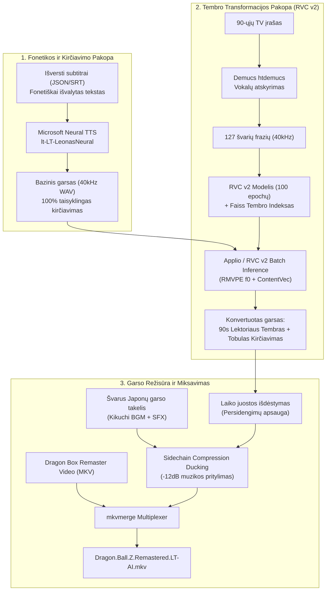

# Dubvertėjas (AI Voiceover & Dubbing Remaster Engine)

> **Tikslas:** Automatizuotas retro animacinių serialų (pvz., *Dragon Ball Z*) ir TV laidų lietuviško įgarsinimo remasteris, apjungiantis aukščiausios kokybės vaizdo/garso šaltinius su nostalgišku 1990-ųjų TV diktoriaus tembru ir **100% taisyklingu lietuvišku kirčiavimu bei natūralia intonacija**.

---

## 1. Projekto Koncepcija ir Problema

### Originalo problema:
Originalūs 1990-ųjų „Tele-3“ / TV3 lietuviški *Dragon Ball Z* įrašai turi kelias dideles problemas:
1. **Triukšmas ir prasta kokybė**: VHS traškesiai, mono garsas, prislopinti dažniai.
2. **Ispaniško garso prasimušimas**: Lietuviškas balsas buvo įrašytas tiesiai ant ispaniško dubliažo, todėl fone nuolat murmėdavo ispaniški balsai.
3. **Vertimo klaidos**: Tekstas dažnai buvo verčiamas iš nuogirdų, trūko prasmės ir tikslumo.

### Ankstesnių AI bandymų trūkumai (kodėl netinka įprastas „Zero-Shot Voice Cloning“):
Išbandžius naujausius globalius daugiakalbius balso klonavimo modelius (*XTTS v2*, *OmniVoice*, *Chatterbox*), išryškėjo esminis trūkumas:
- Šie modeliai **neturi lietuvių kalbos kirčiavimo žodyno (VLKK/LKI G2P)**.
- Lietuvių kalbos kirtis yra laisvas ir kilnojamas. Globalūs modeliai bando kirtį „atspėti“ pagal skiemenis, todėl nuolat kerta galūnes (pvz., taria *„pasiro'dė“* vietoj *„pasi'rodė“*), skamba nenatūraliai, lėtai ir robotiškai.

---

## 2. Hibridinė Architektūra (Sprendimas)

Projektas naudoja **dviejų pakopų hibridinę RVC architektūrą**:



### Kodėl ši architektūra veikia tobulai:
1. **Intonacija ir kirtis (Edge-TTS)**: `lt-LT-LeonasNeural` turi pilną lietuvių kalbos morfologinį žodyną, taisyklingai taria minkštumo ženklus, dvibalsius ir kirčiuoja pagal bendrinės kalbos normas.
2. **Nostalgiškas tembras (RVC v2)**: *Retrieval-based Voice Conversion* išlaiko bazinio garso intonaciją ir kirtį ($f_0$ pikselių kontūrą), tačiau perkelia 1990-ųjų aktoriaus balso stygų rezonansą ir tembrą naudodamas apmokytą Faiss indeksą.
3. **Muzika ir efektai**: Naudojamas originalus japoniškas garso takelis be jokio ispaniško murmėjimo. *Sidechain ducking* dėka japonų muzika ir kovos garsai prityla tik tada, kai lektorius kalba, ir akimirksniu atgyja jam nutilus.

---

## 3. Sistemos Sąranka ir Reikalavimai

- **Operacinė sistema:** Linux (Ubuntu 22.04 / 24.04, Linux Mint ar Debian).
- **GPU:** NVIDIA GPU su CUDA palaikymu (rekomenduojama RTX 3060 / 4060 8GB VRAM ar geresnė).
- **Sisteminiai paketai:**
  ```bash
  sudo apt update
  sudo apt install -y ffmpeg mkvtoolnix git python3-pip
  ```
- **RVC v2 variklis (`tools/Applio`):**
  Projekte jau integruotas moderniausias RVC karkasas `Applio v3.6.6` su suderintu Python 3.11 virtualiuoju venv:
  `tools/Applio/.venv/bin/python`

---

## 4. Projekto Struktūra

```
dubvertejas/
├── README.md                      <- Šis dokumentas (projekto instrukcija kitiems AI/kūrėjams)
├── pipeline.py                    <- Pagrindinis vienos komandos paleidėjas
├── requirements.txt               <- Python bibliotekų sąrašas
├── .gitignore                     <- Taisyklių sąrašas (apsaugo nuo didelių MKV/modelių stūmimo į git)
│
├── src/                           <- Moduliniai Python komponentai
│   ├── subtitle_cleaner.py        <- Teksto fonetinis normalizatorius (skaičiai -> žodžiai)
│   ├── generate_base_tts.py       <- Edge-TTS taisyklingo tarimo generavimas (40kHz WAV)
│   ├── batch_rvc.py               <- Applio RVC v2 paketinis konvertavimas
│   ├── mix_and_remux.py           <- Laiko juosta, sidechain ducking ir MKV sumuksavimas
│   ├── extract_vocals.py          <- Demucs vokalų išskyrimas iš TV šaltinio
│   └── slice_dataset.py           <- Vokalų pjaustyklė naujų RVC modelių apmokymui
│
├── models/                        <- Apmokyti RVC modeliai
│   └── dbz_actor/
│       ├── dbz_actor_100e_2400s.pth  <- 100 epochų apmokytas 90s lektoriaus modelis (53MB)
│       ├── dbz_actor.index           <- Faiss tembro paieškos indeksas (58MB)
│       └── model_info.json           <- Modelio hiperparametrai (40kHz, HiFi-GAN)
│
├── data/
│   ├── datasets/dbz_actor/        <- 127 paruoštos švarios lektoriaus frazės apmokymui
│   ├── translations/              <- Subtitrai su laiko žymomis (ep149_translated_clean.json)
│   └── samples/                   <- Audio pavyzdžiai kokybės palyginimui
│
└── tools/
    └── Applio/                    <- RVC v2 karkasas ir paruošta CUDA aplinka
```

---

## 5. Kaip Paleisti Pilną Remasterį (Automatinis Būdas)

Norint sugeneruoti pilną remasteruotą epizodą:

```bash
tools/Applio/.venv/bin/python pipeline.py \
  --video "/kelias/iki/Dragon.Ball.Z.149.DBox.mkv" \
  --json "data/translations/ep149_translated_clean.json" \
  --model-dir "models/dbz_actor" \
  --output "output/Dragon.Ball.Z.149.Remastered.LT-AI.mkv"
```

Skriptas automatiškai:
1. Išskirs foninį japonų garso takelį.
2. Sugeneruos visus sakinius su taisyklingu kirčiavimu (`generate_base_tts.py`).
3. Konvertuos visų sakinių tembrą į 90-ųjų TV aktorių (`batch_rvc.py`).
4. Išdėlios frazes milisekundžių tikslumu, atliks *sidechain ducking* ir sumuksuos galutinį MKV failą.

---

### OmniVoice su aktoriaus balso pavyzdžiu (be RVC)

Šis variantas generuoja kalbą tiesiogiai su `k2-fsa/OmniVoice`, naudodamas tą patį balso pavyzdį kaip klausymo teste. Lietuvišką tarimą ir kirčius reikia įvertinti klausant.

```bash
tools/Applio/.venv/bin/python src/generate_omnivoice.py \
  --json data/translations/ep149_translated_clean.json \
  --out-dir temp/ep149_omnivoice/dialogue \
  --reference data/samples/reference_90s_actor.flac \
  --reference-text "Selas netrukus taps visagalis."

ffmpeg -y -i media/Dragon.Ball.Z.149.480p.DBox.DVD.REGRADE.LT-ENG-JAP.FLAC2.0.x264-SoM-7urgis.mkv \
  -map 0:2 -c:a flac temp/ep149_omnivoice/bg_audio.flac

tools/Applio/.venv/bin/python src/mix_and_remux.py \
  --json data/translations/ep149_translated_clean.json \
  --rvc-folder temp/ep149_omnivoice/dialogue \
  --bg-audio temp/ep149_omnivoice/bg_audio.flac \
  --video media/Dragon.Ball.Z.149.480p.DBox.DVD.REGRADE.LT-ENG-JAP.FLAC2.0.x264-SoM-7urgis.mkv \
  --output media/Dragon.Ball.Z.149.DBox.Remastered.LT-OmniVoice.mkv \
  --temp-dir temp/ep149_omnivoice --fit-timing \
  --track-name "Lietuvių k. (OmniVoice – aktoriaus balso pavyzdys)"
```

`--rvc-folder` čia yra bendras dialogo WAV katalogas; RVC nevykdomas. `--fit-timing` išlaiko subtitrų pradžias, prireikus pagreitina frazes ir nuosekliai perskaito vienu metu rodomas eilutes. Japoniškas takelis pritylinamas, bet jo dialogas nepašalinamas. Vaizdas nekoduojamas iš naujo; originalūs lietuviškas bei japoniškas garso takeliai išsaugomi pasirinkimui.

## 6. Kaip Apmokyti Naują Balso Aktorių (Naujo Modelio Kūrimas)

Jei norite klonuoti kitą lektorių ar veikėją:

1. **Išskirkite vokalus iš šaltinio garso:**
   ```bash
   tools/Applio/.venv/bin/python src/extract_vocals.py --input raw_audio.flac --output-dir data/demucs_output
   ```
2. **Supjaustykite į frazių rinkinį (1.5s – 10s):**
   ```bash
   tools/Applio/.venv/bin/python src/slice_dataset.py \
     --input data/demucs_output/htdemucs/raw_audio/vocals.wav \
     --output-dir tools/Applio/assets/datasets/naujas_aktorius
   ```
3. **Atlikite paruošimą ir požymių išskyrimą per Applio:**
   ```bash
   cd tools/Applio
   .venv/bin/python core.py preprocess --model-name naujas_aktorius --dataset-path assets/datasets/naujas_aktorius --sample-rate 40000
   .venv/bin/python core.py extract --model-name naujas_aktorius --f0-method rmvpe --sample-rate 40000 --gpu 0
   ```
4. **Paleiskite treniravimą (rekomenduojama 80–100 epochų):**
   ```bash
   .venv/bin/python core.py train --model-name naujas_aktorius --sample-rate 40000 --vocoder HiFi-GAN --total-epoch 100 --batch-size 8 --gpu 0 --save-every-epoch 20 --save-only-latest --pretrained --cache-data-in-gpu
   .venv/bin/python core.py index --model-name naujas_aktorius
   cd ../..
   ```
5. Gautą `.pth` ir `.index` failą iš `tools/Applio/logs/naujas_aktorius/` perkelkite į `models/naujas_aktorius/`.

---

## 7. Svarbios Taisyklės ir Žinomi Niunsai (Būtina Žinoti AI Modeliams)

> [!IMPORTANT]
> **Skaičių ir santrumpų fonetizavimas:**
> Tekste esančius skaičius ir santrumpas būtina paversti žodžiais prieš siunčiant į TTS.
> Pvz., *„Nr. 17“* negalima palikti kaip skaičiaus, nes TTS ištars *„Ener septyniolika“*. Būtina rašyti *„robotas numeris septyniolika“* arba *„septynioliktas“*. Tam naudojamas [`src/subtitle_cleaner.py`](src/subtitle_cleaner.py).

> [!NOTE]
> **Applio vykdymo direktorija (CWD):**
> Vykdant `core.py infer` ar `core.py batch-infer`, komandą būtina leisti nurodžius darbo direktoriją `tools/Applio/` (`cwd=applio_dir`), nes Applio naudoja santykinius kelius vidiniams RMVPE ir ContentVec modeliams rasti.

> [!TIP]
> **Garso miksavimo nustatymai (Sidechain Ducking):**
> Rekomenduojami `sidechaincompress` parametrai natūraliam TV įgarsinimo pojūčiui:
> - `threshold=0.03`, `ratio=4`, `attack=20ms`, `release=350ms`.
> - Balso lygio stiprinimas: `volume=1.3` (užtikrina aiškų, lengvai suprantamą balsą virš sprogimų ir muzikos).

---

## 8. Licencija ir Autorinės Teisės
Šis įrankis skirtas asmeniniam ir edukaciniam naudojimui, archyvinių retro televizijos laidų restauravimui ir remiksavimui. *Dragon Ball Z* autorinės teisės priklauso Akira Toriyama, Bird Studio, Shueisha ir Toei Animation.
